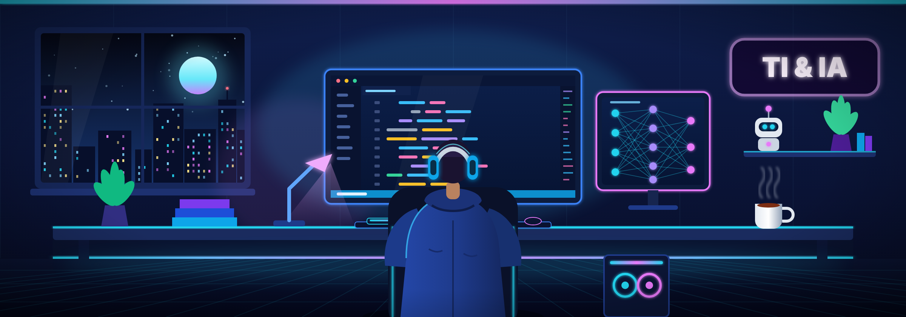

  

<h3 align="center"><code>Transformando café e bugs em soluções</code></h3>

---

  

---

## 👋 Sobre mim

Me chamo Matheus Chagas, tenho 18 anos, sou estudante de **Engenharia de Software** na Universidade Cidade de São Paulo, com interesse em **Desenvolvimento Front-End**, **Inteligência Artificial** e **Análise de Dados**. Atualmente meu foco é desenvolvimento front-end, mas aprimorando minhas habilidades para iniciar full-stack.

📍 São Paulo, Brasil

---

## 🛠️ Tecnologias

  
  
  
  
  

---

  

---

## 📫 Contato

- E-mail: chagasmatheus1211@gmail.com
- Número: 11 99636-1661
- LinkedIn: https://www.linkedin.com/in/matheus-chagas-coque-b190ba39b/

